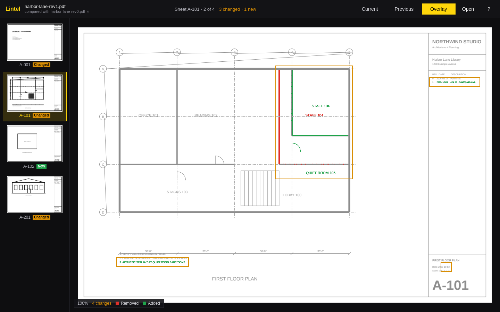

# Lintel

A fast viewer for construction drawing sets, for [Omarchy](https://omarchy.org).
Open a PDF set, flip through its sheets, and overlay an older revision to see
what changed: removed work in red, added work in green.



## What it does

- Opens a PDF drawing set and shows every sheet as a thumbnail.
- Zooms and pans smoothly on large sheets, sharp at any zoom: past a quick
  base image, only the visible part renders, in tiles, at full resolution.
- Compares two revisions. Sheets are paired by their page label (A-101 to
  A-101) when the PDFs label their pages, and by position otherwise.
- Lines the older revision up first when it was re-plotted with a slight
  shift or scale, so the overlay shows real changes, not a misregistration.
- Compares every sheet in the background and marks each one **Changed** or
  **New**, then walks you through the changes one at a time: `]` zooms to the
  next changed area, across sheets.
- Follows the Omarchy theme accent, window rounding, and language live.

Coming later: markup (clouds, arrows, text), measurements with a set scale,
and exporting marked-up sheets to PDF.

## Usage

```sh
lintel                              # then press O, or drop a PDF on the window
lintel drawings.pdf                 # open a set
lintel drawings-rev1.pdf drawings-rev0.pdf   # open a set and compare
```

With a set open, drop a PDF on the left half of the window to open it as the
set, or on the right half to compare with it.

## Shortcuts

| Key | Action |
| --- | --- |
| `O` | Open a drawing set |
| `C` | Compare with an older revision |
| `X` | Close the older revision |
| `Space` | Toggle the overlay |
| `1` / `2` / `3` | Current, previous, overlay |
| `]` / `[` | Next and previous change |
| `N` / `Shift+N` | Next and previous changed sheet |
| `J` / `Page Down` | Next sheet |
| `K` / `Page Up` | Previous sheet |
| `Home` / `End` | First and last sheet |
| `+` / `-` | Zoom in and out |
| `0` / `F` | Fit the sheet |
| Arrow keys | Pan |
| Wheel | Zoom at the pointer |
| Drag, touchpad scroll | Pan |
| `Ctrl` + touchpad scroll, pinch | Zoom |
| `?` | Show or hide shortcuts |
| `Q` | Quit |

## Build

Lintel is C++ and Qt Quick, built with qmake. Qt PDF comes from
`qt6-webengine` on Arch.

```sh
bin/build      # builds build/lintel
bin/test       # runs the tests offscreen
bin/install    # builds and installs the package, so Lintel is in the app launcher
```

## License

MIT. The theme and portal file picker code follows
[Omacut](https://github.com/omacom-io/omacut) by David Heinemeier Hansson, also MIT.
